<h1 align="center">🐈 404 Universe 🌌</h1>

  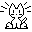

<h3 align="center">Page not found. Cat found. Priorities restored.</h3>

---

## 🔍 What is this?

A 404 page. You were looking for something. It isn't here.

Instead you get:

- 🌠 **2,500 particles** that flee from your mouse like it owes them money
- 🐈 **Oneko**, a very small, very pixelated cat who *will* chase your cursor
- ❤️ **A heart** floating above the cat every 5 seconds, because nobody said 404s can't be wholesome

The top 70% of the screen is the universe. The bottom 30% is **cat territory**. Stay out of the particles, respect the cat.

---

## 🏃 How to run

1. Open `index.html`.
2. There is no step 2.

No npm. No build. No framework. No 400 MB `node_modules` for a cat. 🙏

---

## 🧠 The cat's brain

Oneko has the emotional range of a professional goalkeeper, driven by a tiny state machine:

<table align="center">
  <tr>
    <td align="center"> <b>😱 SURPRISED</b> You moved the mouse. How dare you.</td>
    <td align="center">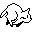 <b>🏃 CHASING</b> Target acquired. Zoomies engaged.</td>
    <td align="center">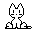 <b>🪑 SITTING</b> Caught it. Now what?</td>
  </tr>
  <tr>
    <td align="center">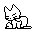 <b>🧼 WASHING</b> Dignity must be maintained.</td>
    <td align="center">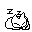 <b>💤 NAPPING</b> Idle for too long. Cat has left the chat.</td>
    <td align="center">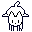 <b>🕳️ DIGGING</b> Mouse left the page. Cat is going after it.</td>
  </tr>
</table>

---

## 🧭 The 8 Directions of Chaos

The cat can run in eight directions, two frames each, so every run looks like it has *somewhere important to be*.

<table align="center">
  <tr>
    <td align="center">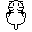 <b>⬆️ Up</b> "Is that a bird?"</td>
    <td align="center">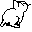 <b>↗️ Up-Right</b> "Probably a bird."</td>
    <td align="center"> <b>➡️ Right</b> "Definitely a bird."</td>
    <td align="center">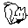 <b>↘️ Down-Right</b> "It's a cursor."</td>
  </tr>
  <tr>
    <td align="center">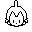 <b>⬇️ Down</b> "Still a cursor."</td>
    <td align="center">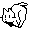 <b>↙️ Down-Left</b> "I will have it."</td>
    <td align="center">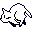 <b>⬅️ Left</b> "MINE."</td>
    <td align="center">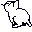 <b>↖️ Up-Left</b> "Where did it go?"</td>
  </tr>
</table>

---

## 🎭 The Second Frames

Every direction has a second frame, so the cat can alternate between them and look like it's actually running instead of sliding around like a sticker.

<table align="center">
  <tr>
    <td align="center">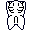</td>
    <td align="center">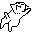</td>
    <td align="center">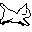</td>
    <td align="center">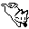</td>
  </tr>
  <tr>
    <td align="center">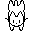</td>
    <td align="center">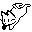</td>
    <td align="center">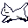</td>
    <td align="center">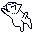</td>
  </tr>
</table>

Left, right, left, right. The cat is not walking. The cat is <i>committing</i>.

---

## 🕳️ Digging at the Edges

Move your mouse off the page and the cat panics and starts digging at the nearest edge to follow you. After a while it gives up and takes a nap, which is relatable.

<table align="center">
  <tr>
    <td align="center">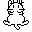</td>
    <td align="center">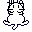</td>
    <td align="center">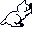</td>
    <td align="center">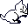</td>
  </tr>
  <tr>
    <td align="center">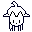</td>
    <td align="center"></td>
    <td align="center">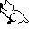</td>
    <td align="center">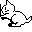</td>
  </tr>
</table>

---

## 😴 The Sleep Cycle

<table align="center">
  <tr>
    <td align="center">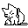 1. "I'm not tired."</td>
    <td align="center"> 2. "Maybe a little."</td>
    <td align="center">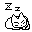 3. "ZzZzZ"</td>
  </tr>
</table>

---

## 🎬 Bonus Cat Content

<table align="center">
  <tr>
    <td align="center">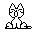 "What? I always look this good."</td>
    <td align="center">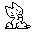 "I have an idea. It involves your cursor."</td>
    <td align="center"> "Do not look at me."</td>
  </tr>
</table>

---

## ❤️ The Heart Protocol

Every **5 seconds**, a heart pops up above the cat. This is not configurable, not negotiable, and not tied to the cat's mood. The cat is always, secretly, in love with you.

  
   
  ♥ ... ♥ ... ♥ ...

---

## 🛠️ Technical Details (for people who read these)

| Thing | Value |
|---|---|
| Framework | None. Just vibes (and JavaScript) |
| Particles | 2,500, drawn on a `<canvas>` |
| Cat tick | 100 ms |
| Cat speed | 24 px per tick, and very smug about it |
| Cat territory | Bottom 30% of the viewport |
| Heart interval | 5 seconds |
| Files that matter | [`index.html`](index.html), [`gif/`](gif) |

---

## 🧪 Testing and QA

There is no automated test runner or build setup. The manual acceptance scenarios are documented in [`TEST-CASES.md`](TEST-CASES.md), and the recorded browser run is in [`TEST-REPORT.md`](TEST-REPORT.md).

The report records 10 of 20 scenarios passing, 4 failing, and 6 not run. It is a dated snapshot, not a verification of the current source. The run used a hidden browser page, so live animation quality was not assessed; keyboard, touch, cross-browser, and deployed-site checks were also not performed. Consult the report for the findings and limitations before relying on those results.

---

## 🙏 Credits

- 🐈 Cat animations from [Sky-creates/Oneko](https://github.com/Sky-creates/Oneko) (public domain / Unlicense, see [`gif/LICENSE`](gif/LICENSE)), with sprites adapted from [jeebuscrossaint/oneko](https://github.com/jeebuscrossaint/oneko)
- 📜 Inspired by the original [Neko](https://en.wikipedia.org/wiki/Neko_(software)) by Naoshi Watanabe, and everyone who ported it to everything ever

---

  
   
  <b>Nothing was found at this URL.</b> 
  <i>But you found a cat. That's better.</i>

